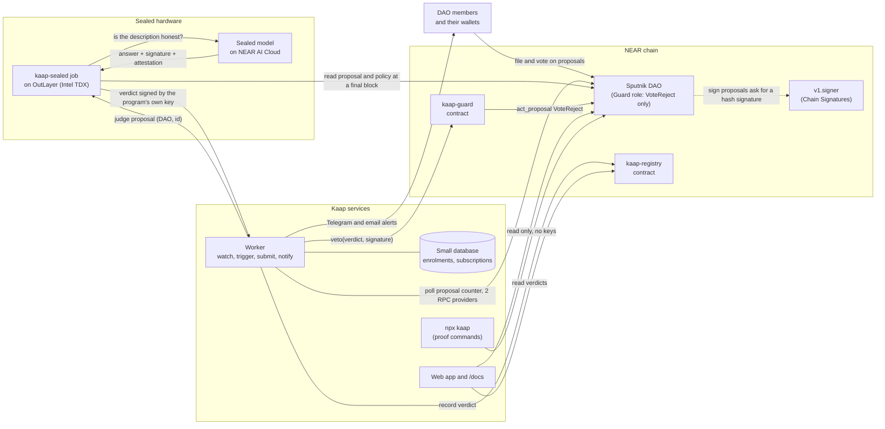
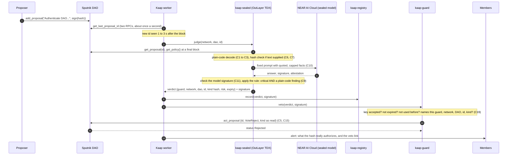
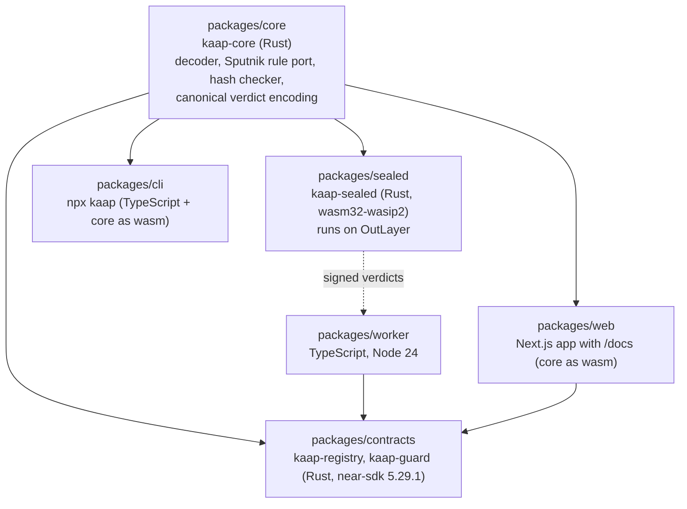

# Kaap architecture

Design chosen at the architecture gate on 20 Oct 2026: the sealed guard, designs B and C of `docs/security/system-description.md` together. This file describes the design as intended. The OutLayer parts are marked "to prove in the early OutLayer trial", as written before that trial ran; the sealed job has since run on OutLayer testnet (`PROOF.md`). Security rules referenced as C1 to C31 are in `docs/security/threat-model.md`.

## In one paragraph
A watcher notices each new proposal of an enrolled Sputnik DAO within seconds. It asks a sealed program running on OutLayer (Intel TDX) to judge it. That program reads the proposal straight from the chain, decodes its real effect with plain code, asks a sealed AI model on NEAR AI Cloud whether the description matches, checks the model's hardware-backed signature, applies the veto rule, and signs a compact verdict with a key that belongs only to that exact program. The verdict is recorded in Kaap's registry contract. If it is critical and backed by a plain-code finding, Kaap's guard contract, the only member of the DAO's reject-only Guard role, checks the signature and casts VoteReject. Nobody, including us, can make the guard vote any other way.

## 1. System overview

## 2. Main sequence: a planted proposal gets vetoed

## 3. Modules and how they depend on each other

One Rust library holds every rule that decides meaning (`packages/core`). The sealed job, the contracts (shared types and the canonical verdict encoding), the CLI and the browser all use the same code, so a judge's laptop, our sealed job and the guard contract compute the same verdict bytes (C14, standard 2).

## 4. Components

| Component | Job | Runs where | Holds |
|---|---|---|---|
| kaap-core | Decode a proposal into effects; port Sputnik's `can_execute_action` and `proposal_status`; recompute NEP-413 hashes and parse intents strictly; encode verdicts canonically | library, compiled for each host | nothing |
| kaap-sealed | Read chain state at a final block, run kaap-core, call the sealed model, check its signature, apply the veto rule, sign the verdict | OutLayer, Intel TDX (to prove in the early OutLayer trial) | its signing key, which never leaves the enclave; texts behind hashes, decrypted only inside |
| kaap-registry | Append-only record of verdicts; never overwritten, only superseded (C13) | NEAR contract | verdict records |
| kaap-guard | The only member of a DAO's Guard role. Casts exactly one thing, VoteReject, and only for a fresh, single-use verdict signed by the accepted key that names it, the network, the DAO, the proposal id and the kind (C15, C19) | NEAR contract | the accepted public key, used-verdict hashes |
| Worker | Watch enrolled DAOs, trigger the sealed job, submit verdicts, send alerts, raise "guard offline" (C18, C21, C22, C27) | small server | RPC and service keys, a gas-paying account with a capped balance |
| Web app | Public DAO and proposal pages, paste box (advisory only, C23), enrolment drafts (C30), member view (C25), verify button (C11, C28), proof page, /docs | Vercel | nothing secret in the browser |
| CLI | Census rerun and evaluation-set run, read only (C31) | the judge's machine | nothing |

## 5. Contracts

Both contracts are immutable: no upgrade method, no full-access key left on the contract account after deploy, code hash published in the README. A new version is a new contract; a DAO moves its Guard role to it with one ordinary proposal.

**kaap-guard** (the interface as planned; the one built is in `packages/contracts/guard/README.md`):
- `veto(verdict: Verdict, signature: [u8; 64])`: callable by anyone, because the signature is the authority. Checks, in order: the signing key is the accepted one; `env::ed25519_verify` passes over the canonical encoding of `verdict`; `verdict.guard` is this contract and `verdict.network` is this network; `verdict.risk` is critical and `verdict.finding` is non-empty (C9); `verdict.expires_at` is in the future; the verdict hash was never used. Then it records the hash and calls `act_proposal {id, action: "VoteReject", proposal: verdict.kind}` on `verdict.dao`, with the kind exactly as the sealed job read it (C5). Gas for the signature check: about 0.21 Tgas (live protocol config, 20 Oct 2026).
- `set_accepted_key(key)`: owner only; emits an event that the worker turns into a member alert (C18). The owner is the founder's account at first.
- Views: `accepted_key()`, `was_used(verdict_hash)`.

**kaap-registry**:
- `record(verdict: Verdict, signature: [u8; 64], explanation_hash: [u8; 32])`: publisher key only (C13); size-capped; append-only.
- Views: `latest(network, dao, id)`, `history(network, dao, id)`.

**Verdict** (canonical, borsh-encoded by kaap-core): `{ guard, network, dao, proposal_id, kind_hash, policy_hash, block_height, risk, finding, decoder_version, model_id, expires_at }`.

## 6. Interface for the frontend
Filled in when the contracts are deployed: testnet addresses, ABI (near-sdk JSON schema), and the exact reads and writes the web app makes. Reads planned: registry `latest` and `history`; DAO `get_proposals`, `get_policy`; kaap-guard `accepted_key`. Writes from the web app: none from Kaap's keys; members sign enrolment proposals and the member-view login (NEP-413) in their own wallets.

## 7. Decisions behind this design
- Polling each enrolled DAO's proposal counter, not a block stream: the free block feed allows 30 blocks a minute (measured 20 Oct), about 30 percent of mainnet.
- The guard never trusts the NEAR AI model key directly: anyone with a NEAR AI key can get a genuine model signature on a request they wrote. It trusts only the key of our sealed program, which checks the model signature itself.
- Fallback by construction: if the OutLayer part fails, the same guard contract accepts a server key instead (designs A and C together). Switching is the guard owner's call, with `set_accepted_key`.
