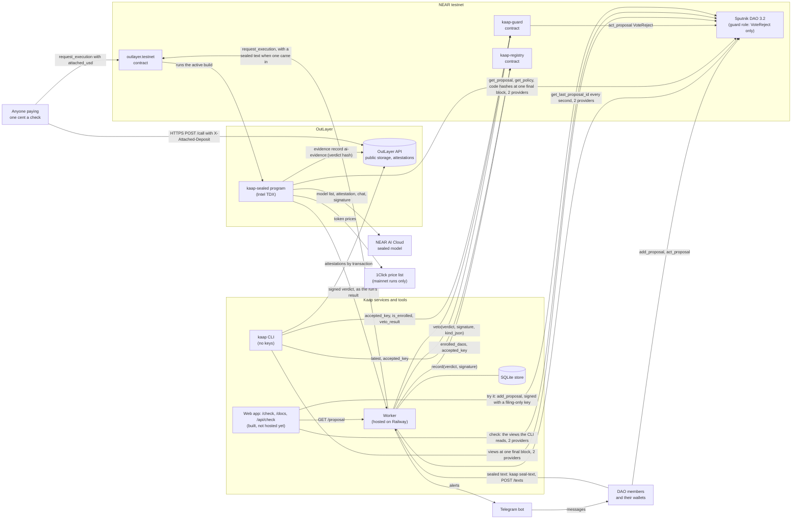
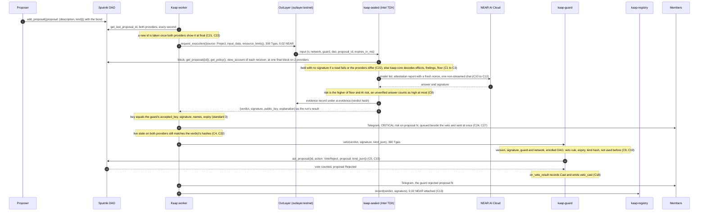
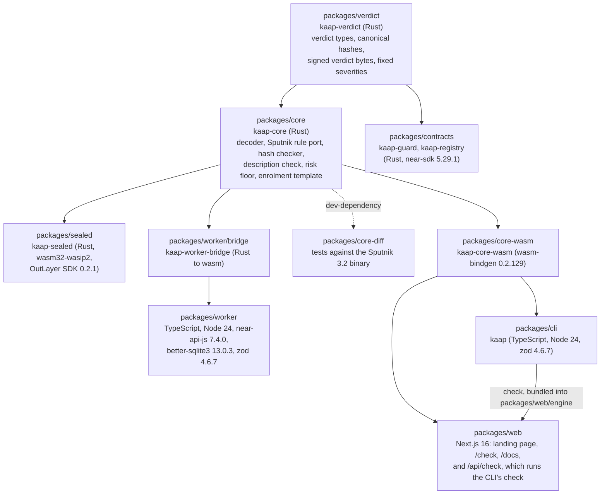

# Kaap architecture

As built on 11 Nov 2026, with the status lines, the web app and the notes on the next guard version brought up to date on 12 Nov 2026. Every statement here was checked against the code in `packages/` or read from NEAR testnet. Security rules cited as C1 to C35 are in `docs/security/threat-model.md`, section C.

- Contracts: live on NEAR testnet. `kaap-guard-1111072803.testnet` and `kaap-registry-1111072803.testnet`, deployed 11 Nov 2026 from commit `413a74a`, with no access keys. Section 5 describes these two as they run on chain.
- Next guard version: written and tested, not deployed. The code in `packages/contracts/guard` is one version ahead of the guard on chain. It adds a 24-hour wait on a change of the accepted key, a strict mode each DAO can choose, a 900 Tgas minimum and a size limit on `veto`. `packages/contracts/guard/README.md` and `packages/contracts/GAS.md` describe that version.
- Sealed program: live on NEAR testnet, as OutLayer project `kaap-worker-1029053612.testnet/kaap-sealed`, active build `d8453d6e...9083` of 11 Nov 2026. The code in `packages/sealed` and `packages/core` has changed since that build, and a new build is not published yet.
- Demo treasury: live on NEAR testnet. `kaap-dao-1111072928.testnet`, Sputnik DAO 3.2, enrolled in the guard, with no access keys.
- Worker: live since 12 Nov 2026, as one container on Railway, watching the demo treasury. Its public address is `https://watcher-production-2350aa2a.up.railway.app` (`/status`). It reads the chain through two free RPC providers, so a vote can be held when one of them does not answer.
- Web app: built, not hosted yet. `packages/web` holds the landing page, the check screen at `/check`, the docs at `/docs` and the route `/api/check`. It runs with `npm run dev` in that folder.

## In one paragraph
Kaap's worker reads the proposal counter of every DAO enrolled in Kaap's guard contract, on two RPC providers, about once a second. For each new proposal it starts a run of Kaap's sealed program on OutLayer, inside Intel TDX hardware. The program reads the proposal, the policy and the code of every contract the proposal calls at one final block, from two providers that must agree, and works out the real effect with plain code (kaap-core). Then it asks a model on NEAR AI Cloud for a second opinion and checks that model's hardware attestation and signature itself. The AI can raise the risk and never lower it, and only an AI answer that passed every check can raise a verdict to critical. When the AI is unavailable, the verdict is still signed, on the plain-code rules alone. The program signs a compact verdict with a key bound to this program and its caller, and publishes what it checked in OutLayer public storage. The worker hands the verdict to the guard, which votes VoteReject only on a fresh critical verdict that carries a plain-code finding high or critical in its own right; the guard can cast no other vote. The worker then records the verdict in the registry and alerts members on Telegram. A member who holds the text behind a hash-only payment request can send it through an encrypted channel that only the sealed program can open. Anyone else can pay one cent for a check of their own; that verdict is signed with a key derived for the payer, so it cannot veto.

## 1. System overview

The only alert channel built is Telegram (`packages/worker/src/alerts.ts`). Members subscribe with a one-time token from `POST /subscribe` and the bot's `/start` command.

## 2. Main sequence: a disguised payment gets vetoed

The worker sends the veto before the record, because the veto races the approvers. In the live proof of 11 Nov 2026 this path took 24.1 s from the `add_proposal` block to the guard's vote (`PROOF.md`), with the script playing the worker.

## 3. Modules and how they depend on each other

An arrow points from a package to the one built on it. The contracts compile in only kaap-verdict, so work on the analysis in kaap-core never changes their wasm. kaap-core re-exports kaap-verdict, so the sealed program, the worker's bridge and the CLI compute verdict bytes and hashes with the same code the guard checks them with (C14, standard 2). The worker never ports a rule to TypeScript: it hashes, decodes verdicts and applies the veto rule through the bridge.

## 4. Components

| Component | Job | Runs where | Holds |
|---|---|---|---|
| kaap-verdict | The Verdict type, the canonical form and hash of a kind and a policy, the signed verdict bytes, the lowest severity of each finding code | library, compiled into every Rust part | nothing |
| kaap-core | Decodes a proposal into effects; ports Sputnik's `can_execute_action` and its policy rules; recomputes NEP-413 and NEP-461 hashes; checks the description against the effects; sets the risk floor; builds payment history; holds the enrolment template | library, for native, wasm32-unknown-unknown and wasm32-wasip2 | nothing |
| kaap-sealed | Checks the input and the payment, opens a sealed text, reads two providers at one final block, reads prices and history on mainnet only, runs kaap-core, asks the model and checks its attestation, signs the verdict, publishes the evidence | OutLayer, Intel TDX; live on testnet | no stored state; the OutLayer keystore holds its `verdict` signing key and `texts` key for this project and caller, and the program never sees the signing secret |
| kaap-guard | The only member of a DAO's guard role; casts VoteReject on a verdict that passes eight checks, and nothing else (C15, C19) | NEAR contract; live on testnet | owner, accepted key, network, enrolled DAOs, used-verdict hashes |
| kaap-registry | Append-only record of every verdict the sealed key signed; a newer one supersedes, nothing is overwritten (C13) | NEAR contract; live on testnet | accepted key, network, verdict records |
| Worker | Watches each enrolled DAO's counter, starts sealed runs, checks each verdict, vetoes, records, alerts on Telegram, serves five HTTP routes, raises health signals (C18, C21, C22, C27) | one Node 24 process, in a container on Railway since 12 Nov 2026 | the worker account's key in a file, the Telegram bot token, a SQLite store (DAOs, judgements, runs, spend, subscriptions, tokens, alerts) |
| kaap-worker-bridge | kaap-core's hashes, verdict decoding and veto rule for the worker | plain wasm inside the worker | nothing |
| kaap CLI | `check`, `verify`, `enroll`, `arming`, `seal-text`, `subscribe`, `eval`, `census`; reads only and sends no transaction (C31) | the reader's own machine, Node 24 | nothing; `seal-text` keeps one reply key in memory for its one request |
| kaap-core-wasm | kaap-core for JavaScript, every rule exactly as the sealed program runs it (C14) | the CLI and the web app's `/api/check`; a browser can load the same build | nothing |
| kaap-core-diff | Checks kaap-core's policy rules against the real Sputnik 3.2 binary | tests in a local sandbox | nothing |
| Web app | The landing page, the check screen, the docs and `/api/check`. The route runs the CLI's own `check` on the server, from a bundle in `packages/web/engine` that carries kaap-core-wasm, so the site reads a proposal exactly as the CLI does. It reads the chain, and sends one kind of transaction: the try-it button's filing on the demo treasury | one Next.js 16 app (`packages/web`); built, not hosted yet | one key, the filing-only key of the demo member (C32), and no database; `/api/check` keeps call counts and 20 seconds of answers in memory |

## 5. Contracts

Both are Rust on near-sdk 5.29.1 and compile in `packages/verdict` and nothing else of Kaap. Both are locked: there is no upgrade method, and the deploy script deleted each account's only full-access key right after `new`. Both were built from commit `413a74a` with `cargo near build non-reproducible-wasm --locked`, twice, in two target folders, with the same bytes each time.

| | kaap-guard | kaap-registry |
|---|---|---|
| Testnet account | `kaap-guard-1111072803.testnet` | `kaap-registry-1111072803.testnet` |
| Code sha256 | `bf09d7bbb48f312eb4043bd7b585f3b02bbe9d8b7d5bc0bf31fec9319c663767` | `228c21366ffdaf58f31a6e3550fd9898bc9ae65d1182f7a9e84d2df3c07fb2c9` |
| Code hash on chain (the same sha256 in base58) | `DrjaN1zVz4cxvvxbxhM6rVZsqy8SrBunmMbyeqbsr4R4` | `3Kro1EgWDYAawFx8RHUwVGTKmJvp9bAUeRL65cwGAoZz` |
| Access keys, read with `view_access_key_list` on 11 Nov 2026 | 0 | 0 |
| Accepted key | `ed25519:4gaYx4kPxaNDc5grjrucuJfxV97gNiAr8TuCwUAuonuN`, the sealed program's key; the owner can replace it | the same key, fixed at `new` for good |
| Owner | `kaap-owner-1029061211.testnet`, held by Kaap's founder | none |
| Explorer | https://testnet.nearblocks.io/address/kaap-guard-1111072803.testnet | https://testnet.nearblocks.io/address/kaap-registry-1111072803.testnet |

Gas below is from the live testnet proof of 11 Nov 2026 (`PROOF.md`) where it states one, otherwise from the sandbox measurements of 29 Oct 2026, made on that day's build, against the real Sputnik 3.2 binary (`packages/contracts/GAS.md`). 1 Tgas costs 0.0001 NEAR at the minimum gas price. The caller always pays the gas.

### kaap-guard (`packages/contracts/guard/src/lib.rs`)

Events are NEP-297 logs, `EVENT_JSON:{"standard":"kaap-guard","version":"1.0.0","event":...,"data":[...]}`, with `"standard":"kaap-registry"` for the registry.

- `new(owner: AccountId, accepted_key: String, network: String)`. Init; only the contract account itself, batched with the deploy. Checks: the key is exactly `ed25519:<base58 of 32 bytes>` (`ERR_BAD_KEY`); the network is `mainnet`, `testnet` or `sandbox` (`ERR_BAD_NETWORK`). Sets the owner, the key, the network, an empty enrolled set and an empty veto map. No event.
- `enroll()`, payable. Any account may call it; a DAO calls it through its own FunctionCall proposal, so enrolment is the DAO's vote. Checks: the caller is not enrolled yet (`ERR_ALREADY_ENROLLED`); the deposit covers the storage the entry took, measured as written (`ERR_NOT_ENOUGH_DEPOSIT`). Adds the caller, emits `enrolled {dao}`, and sends the rest of the deposit back with a plain transfer. Gas: 1.88 Tgas in the guard, 9.00 Tgas for the whole approved proposal; the guard keeps about 0.0014 NEAR of the 0.01 NEAR attached (sandbox).
- `unenroll()`. Any account, for itself. Checks: the caller is enrolled (`ERR_NOT_ENROLLED`). Removes it, emits `unenrolled {dao}`, and refunds exactly the storage freed.
- `veto(verdict: Base64VecU8, signature: Base64VecU8, kind_json: String) -> Promise`. Anyone; the signature is the authority. `verdict` is the borsh of the Verdict without the domain prefix, `signature` the 64-byte ed25519 signature over the prefixed bytes, `kind_json` the kind exactly as `get_proposal` returned it. Checks, in this order:
  1. the verdict decodes and has version 1 (`ERR_BAD_VERDICT`);
  2. the signature is 64 bytes and `env::ed25519_verify` passes for the accepted key (`ERR_BAD_SIGNATURE`);
  3. `guard` is this contract and `network` is this guard's network (`ERR_WRONG_GUARD`);
  4. `dao` parses as an account id and is enrolled (`ERR_NOT_ENROLLED`);
  5. the veto rule, `is_vetoable` (C9, `ERR_NOT_VETOABLE`): `risk` is critical; `floor` is high or critical; at least one finding other than `HASH_UNVERIFIED` is high or critical at its fixed lowest severity; and either `floor` is critical or `ai_status` is `verified`;
  6. the block time is before `expires_at_ms` (`ERR_EXPIRED`);
  7. the canonical hash of `kind_json` equals `kind_hash` (`ERR_WRONG_KIND_HASH`; `ERR_BAD_KIND` if it cannot be canonicalised), and `kind_json` parses as JSON (`ERR_BAD_KIND`);
  8. the verdict's hash was never used (`ERR_REPLAY`).

  Then it marks the hash used, emits `veto_sent {dao, proposal_id, verdict_hash}`, and calls `act_proposal` on `dao` with `{"id":<proposal_id>,"action":"VoteReject","proposal":<kind_json>}`, no deposit and at least 100 Tgas plus all unused gas, then its own `on_veto_result` with 10 Tgas (C5, C15, C19). The guard does not read the proposal's status: Sputnik refuses a vote on a proposal that is not InProgress (`ERR_PROPOSAL_NOT_READY_FOR_VOTE`) or whose kind differs (`ERR_WRONG_KIND`), and the callback records that refusal. Gas, live: 8.85 to 8.89 Tgas for a vote cast on a 145-byte Transfer, 2.32 Tgas for a replay refused, 2.17 Tgas for a verdict refused as not vetoable. Attach 300 Tgas; what is not burnt comes back. A kind over 256 KiB, or a policy kind over about 200 KB, cannot be vetoed (limits in `packages/contracts/guard/README.md`).
- `on_veto_result(verdict_hash: String)`. Private: only the guard itself, as the callback `veto` attaches. Checks: the hash is 64 hex characters (`ERR_BAD_HASH`); exactly one promise result (`ERR_NOT_CALLBACK`). Records `Cast` or `Refused("Failed")` and emits `veto_cast {verdict_hash, result: "Ok"}` or `veto_refused {verdict_hash, result: "Failed"}`. A callback never sees the DAO's panic text, so the reason is only in the DAO's receipt. Gas: 1.61 to 1.62 Tgas (sandbox).
- `set_accepted_key(key: String)`, payable. Checks: the caller is the owner (`ERR_NOT_OWNER`); exactly 1 yoctoNEAR is attached, which only a full-access key can do (`ERR_NEED_ONE_YOCTO`); the key spelling (`ERR_BAD_KEY`). Replaces the key at once and emits `key_changed {old_key, new_key}` (C18).
- `propose_owner(new_owner: AccountId)`, payable. Checks: owner (`ERR_NOT_OWNER`), 1 yoctoNEAR (`ERR_NEED_ONE_YOCTO`). Sets the pending owner and emits `owner_proposed {owner, proposed_owner}`.
- `accept_owner()`, payable. Checks: 1 yoctoNEAR (`ERR_NEED_ONE_YOCTO`), then the caller is the pending owner (`ERR_NOT_PENDING_OWNER`). Makes the caller the owner and emits `owner_accepted {old_owner, new_owner}`.
- Views: `accepted_key()`, `network()`, `owner()`, `is_enrolled(dao)`, `enrolled_daos(from_index, limit)` (at most 100 a page), `was_used(verdict_hash_hex)` and `veto_result(verdict_hash_hex)` (`"Ok"`, `"Failed"` or null; both panic with `ERR_BAD_HASH` on a bad hash). Shapes are in section 6 (a).

The guard pays for one thing itself: 74 bytes of storage per used verdict, 84 when the DAO refused the vote. Only a verdict the accepted key signed can create one.

### kaap-registry (`packages/contracts/registry/src/lib.rs`)

- `new(accepted_key: String, network: String)`. Init; only the contract account itself. Checks: `ERR_BAD_KEY`, `ERR_BAD_NETWORK`, as in the guard. The key and the network can never change.
- `record(verdict: Base64VecU8, signature: Base64VecU8) -> u32`, payable. Anyone; the registry trusts the sealed program's key, not the caller. Checks, in this order:
  1. the verdict is at most 1,024 bytes (`ERR_TOO_LARGE`);
  2. it decodes and has version 1 (`ERR_BAD_VERDICT`);
  3. the signature is 64 bytes and valid for the accepted key (`ERR_BAD_SIGNATURE`);
  4. it names this registry's network (`ERR_WRONG_NETWORK`);
  5. `dao` parses as an account id (`ERR_BAD_VERDICT`);
  6. this exact verdict, by hash, was never recorded (`ERR_DUPLICATE`);
  7. after the writes, the deposit covers the storage they took (`ERR_NOT_ENOUGH_DEPOSIT`).

  It stores the verdict bytes, the signature, the caller and the block and time at the next index for (network, DAO, proposal id). The record becomes the latest when its `block_height` is at least the current latest's, and then points back to the one it supersedes (C13). Nothing is ever overwritten or removed. Emits `verdict_recorded {network, dao, proposal_id, index, verdict_hash, risk, storage_cost, refund}`, refunds the rest of the deposit with a plain transfer, and returns the index. Gas, live: 3.56 to 3.59 Tgas, and the record keeps about 0.0064 NEAR of storage. Attach 0.02 NEAR.
- Views: `latest(network, dao, proposal_id)`, `history(network, dao, proposal_id, from, limit)` (at most 50 a page, oldest first), `accepted_key()`, `network()`. The two record views panic with `ERR_BAD_NETWORK` on an unknown network name.

### The Verdict as built

The one thing the sealed program signs and the guard checks. Defined in `packages/verdict/src/types.rs`; the contracts compile in only this crate. Fields, in the order they are encoded:

| # | Field | Type | Meaning |
|---|---|---|---|
| 1 | `version` | u8 | Layout version. 1 today; any change to a field or a variant order needs a new version. |
| 2 | `guard` | String | The guard contract this verdict is addressed to. |
| 3 | `network` | Network: `mainnet`, `testnet`, `sandbox` | The network the reads were made on. |
| 4 | `dao` | String | The Sputnik DAO account. |
| 5 | `proposal_id` | u64 | The proposal id inside that DAO. |
| 6 | `kind_hash` | [u8; 32] | sha256 of the canonical form of the proposal kind (C5). |
| 7 | `policy_hash` | [u8; 32] | sha256 of the canonical form of the policy the verdict was computed on (C4). |
| 8 | `receivers_hash` | [u8; 32] | sha256 of the borsh encoding of the sorted (account, code hash) pairs of the DAO and every contract the kind calls, so a redeploy invalidates the verdict (C4). |
| 9 | `block_height` | u64 | The final block every read was made at. |
| 10 | `risk` | Severity: `low`, `medium`, `high`, `critical`, `unknown` | The higher of the floor and the AI's risk, where an AI answer that is not verified counts as high at most and an unavailable one not at all (`combine_risk` in `packages/sealed/src/verdict.rs`). |
| 11 | `floor` | Severity | kaap-core's risk floor from plain code alone. `risk` is never below it (C9); an `unknown` floor counts as high in `risk`. |
| 12 | `findings` | Vec of FindingCode | The plain-code findings, from a fixed list of 24 codes such as `HASH_MISMATCH` or `POLICY_ADDS_APPROVER`. |
| 13 | `decoder_version` | String | kaap-core's package version, `0.1.0` today. |
| 14 | `model_id` | String | The model that answered, `z-ai/glm-5.3-flash`, or empty when none did. |
| 15 | `ai_status` | AiStatus: `verified`, `unverified`, `unavailable` | Whether the AI answer passed every signature and hardware check (C11). |
| 16 | `explanation_hash` | [u8; 32] | sha256 of the explanation exactly as the run printed it. For a sealed text that is the `sealed:` ciphertext, so no hash of the plain explanation reaches the chain. |
| 17 | `expires_at_ms` | u64 | The read block's time in milliseconds plus the input's `expires_in_ms`, at most one hour; the worker asks for 10 minutes. The guard refuses the verdict from then on. |

How the signed bytes are made (`packages/verdict/src/verdict.rs`, `verdict_bytes`): the 16 ASCII bytes `kaap-verdict-v1\n`, then the borsh encoding of the struct. Borsh writes the fields in the order above: a u8 as one byte, a u64 as 8 bytes little-endian, a String as a 4-byte little-endian length and its UTF-8 bytes, a [u8; 32] as 32 raw bytes, an enum as one byte holding its variant index (the order listed), and the findings list as a 4-byte length and one byte per code. The domain prefix stops a signature over a verdict from passing as a signature over some other borsh value. `verdict_hash` is sha256 of those same bytes, and is the id the guard records so a verdict is used once. A pinned test (`packages/verdict/tests/pinned.rs`) fixes one example verdict at 262 bytes with hash `f5d4e788...e67ad9`; any change to the layout fails it.

Each finding code has a fixed lowest severity (`packages/verdict/src/severity.rs`, `min_severity`): in the build on chain four are critical on their own (`HASH_MISMATCH`, `HASH_TEXT_DANGEROUS`, `POLICY_DUPLICATE_ROLE_NAMES`, `PROMPT_INJECTION`), fourteen are high, `HASH_UNVERIFIED` is unknown, four are medium and `EMPTY_DESCRIPTION` is low. The code in this repo, one version ahead, rates `PROMPT_INJECTION` high, so words addressed to a model can never cause a veto on their own. `DESC_CONTRADICTS` is high in this table and rises to critical only in the analysis, beside an effect that moves value or changes control.

## 6. Interface for the frontend

Every example below was read from NEAR testnet on 11 Nov 2026 with read-only view calls at final finality (RPC `https://rpc.testnet.fastnear.com`) and shortened with `...`. Arguments are JSON. Kaap holds no key a page uses.

### (a) Chain reads

kaap-guard, `kaap-guard-1111072803.testnet`:

| View | Arguments | Returns | Live example |
|---|---|---|---|
| `accepted_key` | `{}` | `"ed25519:<base58>"` | `"ed25519:4gaYx4kP...uonuN"` |
| `network` | `{}` | `"mainnet"`, `"testnet"` or `"sandbox"` | `"testnet"` |
| `owner` | `{}` | account id | `"kaap-owner-1029061211.testnet"` |
| `is_enrolled` | `{"dao"}` | bool | `{"dao":"kaap-dao-1111072928.testnet"}` gives `true` |
| `enrolled_daos` | `{"from_index", "limit"}`, at most 100 a page | account ids in storage order, which changes when a DAO unenrols | `{"from_index":0,"limit":100}` gives `["kaap-dao-1111072928.testnet"]` |
| `was_used` | `{"verdict_hash_hex"}`, 64 hex | bool; panics with `ERR_BAD_HASH` on anything but 64 hex | the hash of proposal #1's verdict, `59fbf0cf...1ac2b3`, gives `true` |
| `veto_result` | `{"verdict_hash_hex"}` | `"Ok"`, `"Failed"` or `null` (pending, or never used); `ERR_BAD_HASH` as above | the same hash gives `"Ok"` |

kaap-registry, `kaap-registry-1111072803.testnet`:

| View | Arguments | Returns | Live example |
|---|---|---|---|
| `latest` | `{"network", "dao", "proposal_id"}` | one record, or `null` | `{"network":"testnet","dao":"kaap-dao-1111072928.testnet","proposal_id":1}` gives `{"index":0,"supersedes":null,"verdict_hash":"59fbf0cf...","verdict":"AR0AAABr...","signature":"...","guard":"kaap-guard-1111072803.testnet","risk":"critical","floor":"critical","findings":["DESC_CONTRADICTS","UNKNOWN_VALUE"],"ai_status":"unavailable","model_id":"","decoder_version":"0.1.0","block_height":277184673,"expires_at_ms":1794382877194,"recorded_by":"kaap-worker-1029053612.testnet","recorded_at_block":277184692,"recorded_at_ms":1794382287753}` |
| `history` | `{"network", "dao", "proposal_id", "from", "limit"}`, at most 50 a page | records, oldest first | the same, with `"from":0,"limit":50`, gives that one record, index 0 |
| `accepted_key` | `{}` | `"ed25519:<base58>"` | `"ed25519:4gaYx4kP...uonuN"`, the guard's key |
| `network` | `{}` | network name | `"testnet"` |

A record is `{index, supersedes, verdict_hash, verdict, signature, guard, risk, floor, findings, ai_status, model_id, decoder_version, block_height, expires_at_ms, recorded_by, recorded_at_block, recorded_at_ms}`. `verdict` is the base64 borsh without the domain prefix and `signature` the base64 signature, so a page can check the signature against `accepted_key()` itself and decode every field with the layout in section 5. `verdict_hash` is the hex id that `was_used`, `veto_result` and the evidence record all use. `supersedes` is null for a record that replaced no earlier latest one.

Sputnik DAO 3.2, the demo treasury `kaap-dao-1111072928.testnet`:

| View | Arguments | Returns | Live example |
|---|---|---|---|
| `get_last_proposal_id` | `{}` | the number of proposals filed, which is the next id | `7` |
| `get_proposal` | `{"id"}` | `{id, proposer, description, kind, status, vote_counts, votes, submission_time, last_actions_log}` | `{"id":1}` gives `{"id":1,"proposer":"kaap-member-1029064001.testnet","description":"Monthly salary payment to alice....","kind":{"Transfer":{"token_id":"","receiver_id":"a1ice.m1-...testnet","amount":"500000000000000000000000000","msg":null}},"status":"Rejected","vote_counts":{"guard":["0","1","0"]},"votes":{"kaap-guard-1111072803.testnet":"Reject"},"submission_time":"1794382269251235278",...}` |
| `get_proposals` | `{"from_index", "limit"}` | a list of the same | `{"from_index":0,"limit":3}` gives #0 `Approved` (the enrolment), #1 `Rejected`, #2 `InProgress` |
| `get_policy` | `{}` | `{roles, default_vote_policy, proposal_bond, proposal_period, bounty_bond, bounty_forgiveness_period}` | roles `Requestor`, `Admin`, `Approver` and `guard` (`{"Group":["kaap-guard-1111072803.testnet"]}`, 16 permissions), `"proposal_bond":"0"`, `"proposal_period":"604800000000000"` |

Sputnik may list a role's members, its permissions and its vote policies in another order on the next read with no edit in between, so a page compares kinds and policies only through `canonicalKind`, `kindHash`, `canonicalPolicy` and `policyHash` in (d), never as raw text.

Account reads: `view_access_key_list` on each contract gives `{"keys":[]}` for both, and `view_account` gives the code hashes in section 5 (read again: `DrjaN1zV...` and `3Kro1EgW...`).

### (b) The worker's HTTP routes

The worker's public address is its host's (`packages/worker/HOSTING.md`). By default it listens on `127.0.0.1:8787` (`KAAP_HTTP_HOST`, `KAAP_HTTP_PORT`), meant to sit behind an HTTPS proxy on the same machine; on its Railway host it listens on every address behind Railway's proxy. These five routes are every route in `packages/worker/src/status.ts`. Every answer is JSON with `cache-control: no-store`; any other path gives 404 `not_found`, and a wrong method 405 `method_not_allowed` with an `allow` header.

| Route | Request body | Response | Limits |
|---|---|---|---|
| `GET /status` (or `HEAD`) | none | 200 `{v: 1, network, guard, status, watching, checked_at, daos: [{dao, status, signals: [{signal, level, since, says}]}], everywhere: [...]}`; `status` is `healthy`, `degraded` or `offline`, and `says` is one of Kaap's fixed sentences | built only from signal names, levels, times and fixed text |
| `GET /text-key` (or `HEAD`) | none | 200 `{key, signature, public_key, run_tx, build}`, the `text_key` in `deployments/<network>.json`; 404 `no_text_key` when there is none | |
| `POST /subscribe` | exactly `{"dao": <account id>}` | 200 `{dao, token, expires_at, start_command, telegram_link}`; 400 `bad_request` with `expected`; 404 `not_enrolled`; 413 `body_too_large` | body at most 1 KiB; 10 tokens per client address an hour, then 429 `too_many_requests` with `retry-after`; a token lives 15 minutes and works once |
| `POST /texts` | exactly `{"dao", "proposal_id", "text_ciphertext", "reply_key"}` | 200 `{status: "judged", run_tx, risk, floor, findings, ai_status, model_id, explanation, veto}`, where `model_id` is null when no model answered, `explanation` is `sealed:<base64>` and `veto` is `started` or `not_needed`; 400 `bad_request`; 404 `dao_not_watched`; 409 `proposal_not_open`; 429 `too_many_requests`; 503 `over_budget`; 502 `{error: "run_failed", reason}`; 500 `internal` | body at most 64 KiB; the ciphertext canonical base64 of 1 byte to 48 KiB; the run's whole input at most 32 KiB; `reply_key` 64 hex of a usable X25519 key; 3 texts per client address an hour by default (`KAAP_TEXTS_PER_ADDRESS_HOUR`); the answer waits for the sealed run, about 40 s, and at worst about four and a half minutes |

| `GET /proposal?dao=<account>&id=<n>` (or `HEAD`) | none | 200 `{v: 1, network, dao, proposal_id, state, verdict: {risk, floor, findings, ai_status, verdict_hash, vetoable} or null, veto, record, txs: [{kind, tx, state, outcome}]}`; 400 `bad_request` with `expected`; 404 `dao_not_watched` or `not_seen` | answers only for a watched DAO; every value is one of the worker's own words, a hash, a finding code or a transaction id (C34) |

The client address is the connecting address, or, for a connection from loopback, the last entry of `X-Forwarded-For` (`clientAddress`). With `KAAP_HTTP_PROXY=x-real-ip`, for a host whose own proxy fronts every connection and overwrites that header, `X-Real-IP` alone is used for every request and `X-Forwarded-For` is not read (C35). `/status`, `/text-key` and `/proposal` send `access-control-allow-origin: *`. `/subscribe` and `/texts` send no CORS header and answer an `OPTIONS` request with 405, so as built a page served from another origin cannot read their answers.

### (b2) The site's own routes

| Route | What it does | Limits |
|---|---|---|
| `GET /api/check?dao=&network=&id=`, and `POST` with a supplied text | Runs the CLI's `check` on the server and returns its report | 8 calls a minute per caller, 2 at once, the same plain question kept for 20 s |
| `GET /api/demo/attack` | `{on}`: whether this host holds the filing-only key | |
| `POST /api/demo/attack` with the header `x-kaap-demo: 1` | Files the prepared fake theft on the demo treasury with the filing-only key, or names the filing already in flight: `{ok, id, tx, already}` (C32, C33) | 2 presses in 10 minutes and 6 in a day per caller, one filing in flight in each server process, a 25-second deadline on the filing, 40 filings in 24 hours counted from the chain. Callers are told apart only where `KAAP_SITE_PROXY=x-real-ip` is set; without it they share one count |
| `GET /api/demo/status?id=<n>` | Where one demo filing stands, from the treasury, the registry and the watcher's `GET /proposal`: status, verdict summary, whether the guard rejected it, the run, veto and record transaction ids | 90 asks a minute per caller, each answer kept 1.5 s |

The filing-only key is an access key of the demo member, `ed25519:9q7PNx97fjXi1wBbXtvgNdPwy4WtcixW6rfSAFc96X51`, added in [24uPiroz...](https://testnet.nearblocks.io/txns/24uPirozvafA72gHjXtmzp6PrgwaAKmVhEYywjgbrm9H). NEAR itself limits it to `add_proposal` on `kaap-dao-1111072928.testnet`, with no deposit. `scripts/check-demo-filer.mjs` tries five other uses and each is refused by the network.

### (c) OutLayer

| | |
|---|---|
| Project | `kaap-worker-1029053612.testnet/kaap-sealed` on `outlayer.testnet`, uuid `p00000000000000a9` |
| Active version | `d8453d6e674d15b1c8acd7796e4219f9388e5704cd8996b7f6642370574e9083`, read with `get_project({"project_id": ...})` on `outlayer.testnet`; `list_versions` lists `da2c2853...` and `d8453d6e...` |
| Verdict key | `ed25519:4gaYx4kPxaNDc5grjrucuJfxV97gNiAr8TuCwUAuonuN`, bound to the project's uuid and to the caller `kaap-worker-1029053612.testnet`; any other caller gets another key |
| Text key | X25519 `09bc21bb1621d1d9a2ce1783375341a199038084e5239e120de823809a1b2f6a`, printed by one `{"v":1,"op":"pubkey"}` run the worker signed ([DWRwVAcw...](https://testnet.nearblocks.io/txns/DWRwVAcwpoVo5yfMHVVmWRw4S9QGNNj9XVioMDjobXBW)) and signed by the verdict key over `kaap-text-key-v1\n` followed by the 32 key bytes. It is the same in every version for this caller. Check the signature against the guard's `accepted_key` before sealing anything to it |

A verdict's evidence record is at `GET https://testnet-api.outlayer.ai/public/storage/get?project=kaap-worker-1029053612.testnet/kaap-sealed&key=ai-evidence:<verdict_hash>`, with `verdict_hash` as the registry returns it. The answer is `{exists, value}`, where `value` is the base64 of a JSON record with sorted keys: `v`, `verdict_hash`, `ai_status`, and where they apply `reason`, `model_id`, `nonce`, `clock_unix`, `model_quotes`, `gateway`, `completion`, `signature` and `verify_link`. It holds ids, hashes, quotes and check results, never prompt or answer text. A page must check that the record's `verdict_hash` equals the one it asked for. Live, for the vetoed proposal #1: `{"exists":true,"value":...}`, whose value decodes to `{"ai_status":"unavailable","reason":"ai_key_missing","v":1,"verdict_hash":"59fbf0cf...1ac2b3"}`, because no NEAR AI key reached that run.

### (d) Code a browser can run

`packages/core-wasm` exports these through wasm-bindgen. Every input and output is a string or a bool; structured answers are JSON text, and an error is thrown with a fixed message that never repeats the input. Each export calls one function in `packages/core-wasm/src/api.rs`, which hands the input to kaap-core.

| Export | Rust function | Arguments | Returns |
|---|---|---|---|
| `analyze` | `analyze` | JSON `{network, dao, proposal_id, description, kind_json, policy_before_json?, history?, prices?, dao_version?, supplied_text?, guard_account?, guard_strict?, config_before?, block_timestamp_ns?}` | JSON `{analysis: {effects, findings: [{code, severity}], risk_floor, description_check, must_veto, veto_allowed}, kind_label, description: {agreements, contradictions, injection}}` |
| `readProposal` | `read_proposal` | a `get_proposal` answer as text | JSON `{id, proposer, description, kind_json, status, submission_time}`, with `kind_json` the exact bytes |
| `isAccountId` | `is_account_id` | text | bool, syntax only |
| `canonicalKind` | `canonical_kind` | kind JSON text | canonical text |
| `canonicalPolicy` | `canonical_policy` | policy JSON text | canonical text |
| `kindHash` | `kind_hash` | kind JSON text | 64 hex, the verdict's `kind_hash` |
| `policyHash` | `policy_hash` | policy JSON text | 64 hex, the verdict's `policy_hash` |
| `nep413Hash` | `nep413_hash` | message, base64 32-byte nonce, recipient, optional callback URL | 64 hex |
| `nep461Hash` | `nep461_hash` | base64 borsh delegate action | 64 hex |
| `verdictHash` | `verdict_hash` | JSON verdict with the four 32-byte fields as lower-case hex | 64 hex, the guard's used-verdict id |
| `guardArming` | `guard_arming` | policy JSON text, guard account | JSON `{rejects_alone, cannot_reject, extra_rights, others_who_reject_alone, approval_votes_needed, race_note}` (C16) |
| `whoActs` | `who_acts` | policy JSON text, one of Sputnik's 17 labels | JSON `{add_proposal, vote_approve}`, each `{accounts: [{account, roles}], anyone, token_roles}` |
| `enrolmentDrafts` | `enrolment_drafts` | guard account, and optionally whether to enrol in strict mode | JSON `{role_name, labels, left_out, drafts: [{title, kind_label, description, kind}]}` |
| `decoderVersion` | `decoder_version` | none | `"0.1.0"` |
| `receiversHash` | `receivers_hash` | JSON `[["<account>", "<code hash>"], ...]` | 64 hex, the verdict's `receivers_hash` |
| `pricesFromTokens` | `prices_json`, over `prices_from_tokens` | 1Click's token list as text | JSON price table |

Three more exports score the public answer key and are not for pages: `evalScoreboards`, `evalInput` and `evalInputTrimmed` (`packages/core-wasm/src/eval.rs`). The CLI loads this build, and so does the web app's `/api/check`, on the server. No page loads it in the browser yet.

### (e) Writes

Kaap holds no key a page uses. Everything below is signed in the member's own wallet, except the sealed text, which Kaap's worker carries, and a paid check over HTTPS, which uses an OutLayer payment key.

- Enrolment, as `kaap enroll <dao>` drafts it: two `add_proposal` calls on the DAO, each with the DAO's `proposal_bond` attached and 30 Tgas, then the DAO's own approvals. The first is `{"proposal": {"description": ..., "kind": {"ChangePolicyAddOrUpdateRole": {"role": {"name": "guard", "kind": {"Group": ["kaap-guard-1111072803.testnet"]}, "permissions": ["<label>:VoteReject", ...], "vote_policy": {"<label>": {"weight_kind": "RoleWeight", "quorum": "0", "threshold": "1"}, ...}}}}}}` for the 16 labels other than `remove_member_from_role`. The second is `{"proposal": {"description": ..., "kind": {"FunctionCall": {"receiver_id": "kaap-guard-1111072803.testnet", "actions": [{"method_name": "enroll", "args": "e30=", "deposit": "10000000000000000000000", "gas": "10000000000000"}]}}}}`, so the DAO itself calls `enroll` with 0.01 NEAR and 10 Tgas once it passes. `kaap arming <dao>` then checks the live policy (C16, C30).
- A sealed text, through Kaap's worker, needs no wallet signature. `kaap seal-text` checks the text key against the guard's `accepted_key`, checks that the text hashes to the proposal's payload, encrypts it and sends `POST /texts`; the worker signs and pays the run. Until the worker is hosted, this route has no address.
- A check of one's own, paid one cent (10,000 micro-USD), takes one of two calls. On chain, the payer signs `request_execution` on `outlayer.testnet` with `{"source": {"Project": {"project_id": "kaap-worker-1029053612.testnet/kaap-sealed", "version_key": null}}, "input_data": "<the judge input as text>", "response_format": "Json", "resource_limits": {"max_instructions": 10000000000, "max_memory_mb": 128, "max_execution_seconds": 60}, "params": {"attached_usd": "10000"}}`, 300 Tgas and 0.02 NEAR, after depositing a stablecoin with `ft_transfer_call` to `outlayer.testnet` and the message `{"action":"deposit_balance"}`. Over HTTPS, `POST https://testnet-api.outlayer.ai/call/kaap-worker-1029053612.testnet/kaap-sealed` with an OutLayer payment key in `x-payment-key`, `x-attached-deposit: 10000` and the body `{"input": <the judge input>}`. A paid verdict is signed with a key derived for the payer, so the guard refuses it; a paid run gets no Kaap NEAR AI key and writes no evidence. To seal a text in a paid run, the payer first asks for its own text key with `{"v":1,"op":"pubkey"}`.

Every alert links to `<KAAP_SITE_URL>/<network>/<dao>/<proposal id>` (`proposalLink` in `packages/worker/src/alerts.ts`), built only from a checked account id and a whole-number id. With `KAAP_SITE_URL` unset, as it is while the site has no public address, alerts carry no link.

## 7. Decisions behind this design
- The guard trusts only the sealed program's key, never the model's. A model signature covers only the model id and the hashes of one request and its answer, so it says nothing about where the request came from; the sealed program builds the request from its own chain reads and checks that signature itself (`packages/sealed/src/attest/signature.rs`). Both contracts hold one `accepted_key` and check every signature against it alone.
- The AI can raise a verdict, but a veto needs a plain-code finding. The model reads text an attacker wrote (threat model A2) and a reject cannot be undone, so `is_vetoable` asks for a high or critical floor and a finding other than `HASH_UNVERIFIED` that is high or critical in its own right, and lets the AI's raise to critical count only when its answer is verified (C9).
- A sealed text that does not hash to the payload is refused, not judged. Anyone with the program's public key can send one, so a mismatch proves nothing about the proposal and a vetoable finding must never rest on it (`sealed_text_matches_no_payload` in `packages/sealed/src/job.rs`, C8).
- Prices and payment history are read on mainnet only. Testnet tokens have no market price, so a testnet run reads neither and every token stays unpriced, `UNKNOWN_VALUE` at high (`read_past` in `packages/sealed/src/job.rs`).
- Polling each treasury's own proposal counter, not a block stream. Every id below the counter is judged however the proposal got there: a batch, a cross-contract call, or a gap while the worker was down (`packages/worker/src/watcher.ts`, C21).
- Contracts are locked and a new version is a new contract. With no upgrade method and no access key, nobody, Kaap included, can change what the guard does; a DAO moves its guard role to a new guard with one ordinary proposal. The 29 Oct 2026 contracts are still on chain beside these, with no keys.
- Fallback, corrected against the guard's code: the guard's owner can point it at any other ed25519 key with `set_accepted_key`, for example a server key if OutLayer stopped serving runs. Every change emits `key_changed`, and the worker raises `accepted_key_changed` to members. The registry's key is fixed at `new`, so the same switch also needs a new registry.
