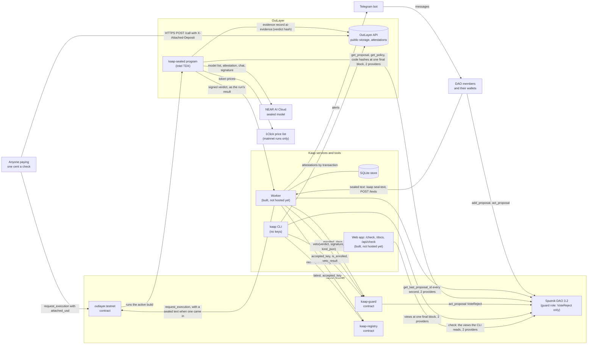
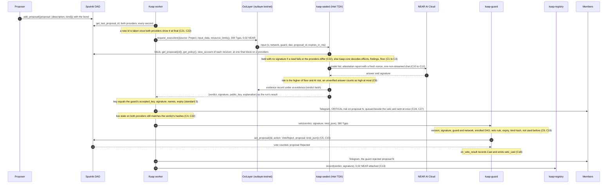
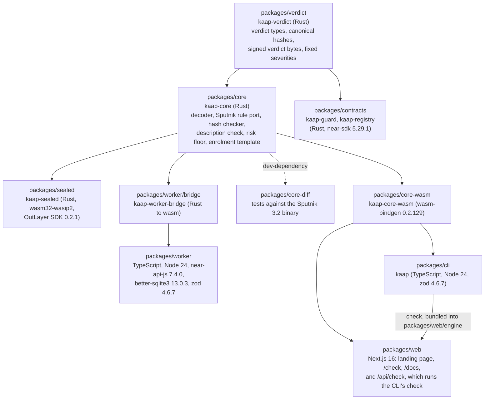

# Kaap

Kaap comes from the Tamil word kaappu (காப்பு), protection: what it gives a treasury. It is a guard for NEAR treasuries that reads every payment request before the members sign it, and that can stop a theft but can never make one.

It only works on NEAR. Sputnik DAO lets a role hold the reject vote and nothing else, OutLayer signs each verdict inside sealed hardware, NEAR AI's models prove which model answered, and Chain Signatures' sign-a-hash requests are where treasuries sign blind today.

[Proof on testnet](PROOF.md) · [Architecture](ARCHITECTURE.md) · [Threat model](docs/security/threat-model.md) · [Evaluation](packages/sealed/AI-EVAL.md) · [Docs](packages/web/content/docs/index.mdx)

Built at NEAR HACKATHON, November 2026. Tracks: social, security, privacy, open.

## The problem

A NEAR treasury is a Sputnik DAO. A member files a request, the approvers read its description, and they sign. The description is whatever the member typed. Nothing checks it against what the request does.

It gets worse with confidential payments. There the request asks the treasury to sign a 64-character hash through Chain Signatures, and the chain holds only the hash. An approver sees this:

```
Authenticate DAO for confidential intents
payload: fcccd15e7cfcd8489a86c110f3e466c66bb12bca6a32ff5ed0151f21d5d10c7f
```

Those 64 characters, on Kaap's demo treasury, are an instruction to add a new key with full control of the treasury's balance on NEAR Intents. Nobody can tell from the screen.

It is not rare. In the year to 12 Nov 2026, 2,622 requests asked a NEAR treasury to sign a hash this way, 38% of all the contract calls filed with treasuries, and 2,271 of them were approved. That is a count of all 2,135 treasuries the Sputnik DAO factory has made, and anyone can recount it from mainnet:

```bash
node packages/cli/dist/src/bin.js census
```

The full count takes about 15 minutes at five requests a second. `census --sample 200` reads a fixed sample of 200 treasuries in about a minute and a half.

## What Kaap does

Kaap reads each new request the moment it is filed, works out what it will really do, and compares that with what it says. When plain code can prove a theft, a contract that sits in the treasury as a reject-only member votes it down before the approvers sign.

| | Signing today | With Kaap |
|---|---|---|
| What an approver sees | The description the proposer typed. For a hash request, 64 characters | What the request does, worked out from its contents |
| A description that lies | Nothing compares it with the payment | Plain code compares the two. A contradiction on money or control is rejected |
| A hash-only request | Signed on trust | Flagged as unreadable. Once a member supplies the words, Kaap checks they produce that hash and reads what they do |
| Who can stop a bad request | A member who notices in time | The guard. In the recorded run its reject landed 24.1 seconds after the request was filed |
| What the stopper could do wrong | Any member with a vote can also approve | The guard's role holds reject votes only. It cannot approve, pay, file a request or change a rule |

A treasury adopts Kaap with two of its own requests: one adds a role named `guard` with Kaap's contract as its only member, and one enrols the treasury. No treasury contract changes, and the guard's role leaves out one kind of request, removing a member from a role, so the guard can never block its own removal.

## What is live, and what is not

| Thing | Where | State |
|---|---|---|
| Guard contract | [`kaap-guard-1111072803.testnet`](https://testnet.nearblocks.io/address/kaap-guard-1111072803.testnet) | Live on testnet, no access keys |
| Registry contract | [`kaap-registry-1111072803.testnet`](https://testnet.nearblocks.io/address/kaap-registry-1111072803.testnet) | Live on testnet, no access keys |
| Demo treasury | [`kaap-dao-1111072928.testnet`](https://testnet.nearblocks.io/address/kaap-dao-1111072928.testnet) | Sputnik DAO 3.2 with the role setup of a NEAR Business treasury, enrolled, no access keys |
| Sealed reader | OutLayer project `kaap-worker-1029053612.testnet/kaap-sealed` | Live on testnet, running inside Intel TDX |
| A theft stopped | Request #1 of the demo treasury | [filed](https://testnet.nearblocks.io/txns/GaQuPteeaiPAqjow7ezLC7f2HqxbBHv53erE1N4C7g9A), [read in sealed hardware](https://testnet.nearblocks.io/txns/az5yNU7xixz2Qwrt8g4pNhygJTpceRqHJTK2zv7NF3J), [recorded](https://testnet.nearblocks.io/txns/2T8fbLoy9gkFkbLThTMPsbRCf4RckfZVMVBvwvfqePmy), [rejected by the guard](https://testnet.nearblocks.io/txns/AWWzynnmDdCYaKeSJA66Kr3h7DxW6ni9Sh6uHtH6v4M9) |
| The check, the site and the docs | `packages/web`, `packages/cli` | Built. The check reads any Sputnik DAO on mainnet or testnet with no key |
| Always-on watcher | `packages/worker` | Built and tested, not hosted. In the recorded run a script played its part |
| Next guard version | `packages/contracts/guard` | Written and tested, not deployed. It adds a 24-hour wait on key changes and a strict mode |
| Mainnet | | Not deployed. Kaap reads mainnet treasuries and does nothing else there |

## Try it in two minutes

No wallet, no key and no test tokens are needed for any step here.

### On the site

1. Open the site and press **Check a treasury**.
2. Press **Read the demo treasury's hash-only request**. You see request #7, "Authenticate DAO for confidential intents", one finding, `HASH_UNVERIFIED`, and the line "The guard will not veto this. Members decide." Kaap cannot read a bare hash and says so.
3. Press **Use the words saved for this demo request**. Kaap checks that the words hash to the request's 64 characters, then reads them. You see a second effect, an intents key change that adds a key, the findings `HASH_TEXT_DANGEROUS` (critical) and `INTENTS_KEY_CHANGE` (high), and "Kaap's guard must veto this."
4. Go back to the home page and press **Watch a theft get stopped**. You see request #1: it says "Monthly salary payment to alice...", it pays `a1ice...`, and under it are the four transactions of the run that rejected it, each a link to the explorer.
5. Now a real one. On the check screen type a mainnet treasury, for example `marketing.sputnik-dao.near`, set **Network** to **Mainnet**, and press **Read it**. Kaap reads its latest request from two providers at one final block.

To run the site yourself, with Node 24, from a clone of this repository:

```bash
cd packages/web
npm install
npm run dev
```

Then open http://localhost:3000.

### In a terminal

Node 24 or newer is all you need, on Linux, macOS or Windows. The engine is committed as WebAssembly, so nothing here compiles Rust, and the first line installs only the command line's own packages.

```bash
git clone https://github.com/ramakrishnanhulk20/kaap.git
cd kaap
npm ci -w packages/cli
npm run build:ts -w packages/cli
node packages/cli/dist/src/bin.js check kaap-dao-1111072928.testnet 1
```

You see what the rejected request really does, read live from testnet. The lines about how it was read are left out here:

```
kaap check kaap-dao-1111072928.testnet #1 on testnet
status: Rejected, proposer kaap-member-1029064001.testnet
description: Monthly salary payment to alice.m1-1111073049.kaap-member-1029064001.testnet.

effects
  transfer: amount 500000000000000000000000000 (500 NEAR), to a1ice.m1-1111073049.kaap-member-1029064001.testnet, token near
findings
  DESC_CONTRADICTS           critical
  UNKNOWN_VALUE              high
  NEW_RECIPIENT              medium
risk floor: critical
description check: contradicts
  contradicts: the named recipient is not paid
must_veto: true
veto_allowed: true
```

Then check the verdict the guard acted on, down to the sealed run that signed it:

```bash
node packages/cli/dist/src/bin.js verify kaap-dao-1111072928.testnet 1
```

It prints 24 checks and ends with these lines, with a newer block number:

```
proposal 1 is Rejected at block 277347795
AI evidence: none. This verdict carries no AI answer (AI unavailable), so there is nothing for https://cloud.near.ai/verify to check
the guard voted to reject with this verdict, and the DAO took the vote

result: all 24 checks pass; 12 of the passes rest on one node or on OutLayer's API alone, as their lines say
```

The checks cover the contracts' code hashes and missing keys, the sealed signature against the guard's key, every hash in the verdict recomputed from the chain, the sealed run's transaction, and OutLayer's attestation of that run. The output also names the one thing it does not check, Intel's signature on the hardware quote, and gives OutLayer's command for that.

Last, rerun the evaluation's plain-code part, with no network:

```bash
node packages/cli/dist/src/bin.js eval
```

It runs the rules engine over 373 labelled requests and prints how often it agrees with the labels, measure by measure. The first table ends with `all six fields  341  373  91.4%`, and `must_veto` agrees on 371 of 373.

Any other treasury works the same way. `kaap check <dao> [id]` reads mainnet for any account that does not end in `.testnet`.

## How it works

1. **Read.** For each new request, Kaap's sealed reader, a program running on OutLayer inside Intel TDX hardware, reads the request, the treasury's rules and the code of every contract the request calls, at one final block, from two RPC providers that must agree.
2. **Judge with plain code.** The rules engine, `kaap-core`, decodes the request into its real effects and raises findings from a fixed list of 24. It compares the description with the effects, and for a hash request it recomputes the hash from any supplied text (NEP-413 and NEP-461) and reads the intents inside.
3. **Ask the AI.** The reader asks a model on NEAR AI Cloud for a second opinion and checks that model's hardware attestation and response signature itself. The AI can raise the risk and never lower it. With no AI answer, the verdict is still signed on the plain-code rules alone.
4. **Sign.** The reader signs a compact verdict with a key that OutLayer binds to this program and its caller.
5. **Veto.** Anyone may hand the verdict to the guard contract. The guard checks the signature, the treasury, the expiry and that the request is the one the verdict judged, and votes `VoteReject` only when the risk is critical and a plain-code finding is high or critical in its own right. The AI alone can never cause a veto.
6. **Record.** The verdict goes into the registry contract, append-only, so anyone can check later what Kaap said and when.

### System



### A disguised payment gets vetoed



### Modules



[ARCHITECTURE.md](ARCHITECTURE.md) has every contract method, the verdict's byte layout and the interfaces between the parts.

## Features

**For an approver**
- One sentence on what a request will really do, for all of Sputnik's proposal kinds: payments, contract calls, rule changes, upgrades, sign requests.
- A check of the description against the effects. "Pays alice" on a request that pays `a1ice` is a contradiction.
- A reading of hash-only requests once the words behind the hash are supplied, with proof that the words match the hash.
- A sealed channel for those words: `kaap seal-text` encrypts them so only the sealed reader can open them. It goes through the watcher, so it has no public address until the watcher is hosted.

**For the treasury**
- A guard that can only reject. It holds no funds and cannot approve, pay or change a rule.
- A veto rule that needs proof from plain code. An unreadable hash alerts members and is not vetoed.
- Each verdict works once, expires within an hour at most, and is tied to one request by its hash.
- Locked contracts: no upgrade method and no access key. A new version is a new contract the treasury chooses to adopt.

**For anyone checking Kaap**
- `kaap check` and `kaap verify`, with no keys, on any machine with Node 24.
- A public record of every verdict in the registry, and an evidence record of what the AI check found.
- The evaluation, with its misses published: [packages/sealed/AI-EVAL.md](packages/sealed/AI-EVAL.md).
- A paid check of one's own for one cent through an OutLayer payment key. Its verdict is signed with a key derived for the payer, so it can never veto.

## NEAR tools used

| NEAR tool | What Kaap uses it for | Where in the code |
|---|---|---|
| Sputnik DAO 3.2 | The guard is the only member of a role that holds `VoteReject` and nothing else, and the veto is one call to `act_proposal`. The engine ports Sputnik's own rules for who may act and how votes are counted, and tests the port against the real 3.2 binary | `packages/contracts/guard/src/lib.rs`, `packages/core/src/policy/sputnik.rs`, `packages/core-diff/tests/sputnik_diff.rs` |
| near-sdk 5.29.1, cargo-near 0.22.0 | The guard and registry contracts, with NEP-297 events | `packages/contracts/guard`, `packages/contracts/registry` |
| OutLayer | Runs the reader inside Intel TDX, holds its signing and text keys, stores the evidence record, attests every run, and takes payment for the one-cent check | `packages/sealed/src/job.rs`, `packages/sealed/src/host.rs`, `packages/sealed/src/payment.rs`, `packages/sealed/src/texts.rs`, `packages/cli/src/outlayer.ts` |
| NEAR AI Cloud | The second opinion, from a model on sealed hardware. The reader checks the model's Intel TDX quote and the signature on its answer | `packages/sealed/src/ai.rs`, `packages/sealed/src/attest/tdx.rs`, `packages/sealed/src/attest/signature.rs` |
| Chain Signatures (`v1.signer`) | Kaap recognises a request that asks the treasury to sign a hash, and recomputes that hash from a supplied text | `packages/core/src/hash/sign.rs`, `packages/core/src/hash/nep.rs`, `packages/core/src/hash/delegate.rs` |
| NEAR Intents | Reads what the intents inside a signed text authorise, decodes calls on `intents.near`, checks 1Click quotes, and prices tokens from the 1Click token list | `packages/core/src/hash/intents.rs`, `packages/core/src/decode/intents.rs`, `packages/core/src/hash/quote.rs`, `packages/sealed/src/prices.rs` |
| NEAR RPC | Every read is made at one final block on two providers that must agree | `packages/sealed/src/reads.rs`, `packages/cli/src/chain.ts` |
| near-api-js 7.4.0 | The deploy, setup and proof scripts, and the watcher | `scripts/prove.mjs`, `scripts/setup-demo-dao.mjs`, `packages/worker/src` |

Other libraries: Rust 1.93.0 with borsh, serde and ed25519-dalek; wasm-bindgen 0.2.129; Phala's dcap-qvl 0.7.1 for the Intel TDX quote; TypeScript 7 on Node 24 with zod; better-sqlite3 in the watcher; Next.js 16, React 19, Tailwind 4, Framer Motion, Lenis, Fumadocs and Mermaid in the site. The landing film is rendered in Blender from the scripts in `art/`.

## Testnet deployment

Deployed 11 Nov 2026 from commit `413a74a`. Every id is also in [deployments/testnet.json](deployments/testnet.json).

| | Account or id | Proof |
|---|---|---|
| Guard | `kaap-guard-1111072803.testnet` | [deployed](https://testnet.nearblocks.io/txns/DEta1bNNm4gRYLqhZJ2HfwDnVtz294dgyEyLfiQVzsK1), [key deleted](https://testnet.nearblocks.io/txns/6qEFvNiz5Guw1w2XaA6cS36kkRVhAJbPTtijgPEcTssM), code sha256 `bf09d7bb...663767` |
| Registry | `kaap-registry-1111072803.testnet` | [deployed](https://testnet.nearblocks.io/txns/53xJksmZUhokY6rVNzXNcnadxAUEaN1RWPkdhJwMwiT7), [key deleted](https://testnet.nearblocks.io/txns/GxMNoCaecyMRfF5k1dqtsxB4uCydKz8fUpzBkMm9gUF1), code sha256 `228c2136...7fb2c9` |
| Demo treasury | `kaap-dao-1111072928.testnet` | [deployed](https://testnet.nearblocks.io/txns/GJDgwXkEEFqrRR4p24ruZrjdvtcM3Hrp9r1RboWx3ePz), [key deleted](https://testnet.nearblocks.io/txns/GWAwWeDcpid7d2snZx2xY1t1qXvrFerztKgaZ7gJY2hZ), enrolled by its own request #0 |
| Sealed reader | `kaap-worker-1029053612.testnet/kaap-sealed` on `outlayer.testnet` | [the attested run that printed its key](https://testnet.nearblocks.io/txns/7HvniWe5JKgqARsiWW8onQpSw1rPcHWiNG4vLwBtekSC) |
| Verdict key | `ed25519:4gaYx4kPxaNDc5grjrucuJfxV97gNiAr8TuCwUAuonuN` | the one key the guard and the registry accept |

NEAR has no contract verification service like Etherscan's, so `kaap verify` does the equivalent: it reads each contract's code hash from two providers and compares it with the build recorded in this repo, and confirms the account has no access key.

## The full proof run

[PROOF.md](PROOF.md) is the record of `node scripts/prove.mjs` on 11 Nov 2026: a member files a disguised payment, the sealed reader judges it, the verdict is recorded, the guard rejects it, a replay of the same verdict is refused, and an honest payment passes through untouched. It passed twice in a row on fresh requests.

That script signs with Kaap's own testnet keys, so in another clone it stops with "no key". The commands in "Try it in two minutes" check what those runs left on chain, and need none.

## Build and test everything

The no-key commands above need only Node 24. Building the contracts and the engine needs Linux or WSL, with:

- Rust 1.93.0 (`rust-toolchain.toml` installs it with its wasm targets)
- cargo-near 0.22.0 and wasm-bindgen-cli 0.2.129
- Node 24

```bash
bash scripts/fetch-sputnik-wasm.sh      # the real Sputnik DAO 3.2 binary the sandbox tests run against
cargo test --workspace                  # engine, verdict format, contracts, sealed reader
npm ci
npm test -w packages/cli
npm test -w packages/worker
```

To rebuild the committed engine and compare it with the one in the repo:

```bash
npm run build:wasm -w packages/cli
sha256sum packages/cli/wasm/kaap_core_wasm_bg.wasm packages/web/engine/kaap_core_wasm_bg.wasm
```

### Test results

Run on 12 Nov 2026 on Ubuntu under WSL, with Rust 1.93.0 and Node 24.22.2.

`cargo test --workspace`: **607 passed, 0 failed.**

| Package | Tests | What they cover |
|---|---|---|
| kaap-core | 244 | The decoder, the Sputnik rule port, the hash checker and the description check: unit, property and golden tests, plus five suites that score the engine against the labelled set |
| kaap-core-diff | 2 | The rule port and the real Sputnik DAO 3.2 binary, run on the same inputs in a sandbox. About 16 minutes |
| kaap-core-wasm | 14 | The WebAssembly interface the command line and the site call |
| kaap-guard | 98 | 66 unit tests, and 32 in a sandbox against the real Sputnik DAO 3.2 binary. These test the guard in this repo, the version not deployed yet |
| kaap-registry | 24 | 17 unit tests and 7 in the sandbox |
| kaap-sealed | 222 | The reader: two-provider reads, the AI answer, each attestation check, payment, sealed texts, signing |
| kaap-verdict | 3 | The verdict's bytes and hash, pinned |

The lines cargo printed for the contracts and the two sandbox suites:

```
     Running unittests src/lib.rs (kaap_guard)
test result: ok. 66 passed; 0 failed; 0 ignored; 0 measured; 0 filtered out; finished in 1.02s
     Running ../tests/guard.rs (guard_sandbox)
test result: ok. 32 passed; 0 failed; 0 ignored; 0 measured; 0 filtered out; finished in 120.81s
     Running unittests src/lib.rs (kaap_registry)
test result: ok. 17 passed; 0 failed; 0 ignored; 0 measured; 0 filtered out; finished in 0.90s
     Running ../tests/registry.rs (registry_sandbox)
test result: ok. 7 passed; 0 failed; 0 ignored; 0 measured; 0 filtered out; finished in 19.00s
     Running tests/sputnik_diff.rs (sputnik_diff)
test result: ok. 2 passed; 0 failed; 0 ignored; 0 measured; 0 filtered out; finished in 981.51s
```

`npm test -w packages/cli` and `npm test -w packages/worker`, run in a fresh clone of this repository:

```
ℹ tests 107
ℹ pass 107
ℹ fail 0

ℹ tests 130
ℹ pass 130
ℹ fail 0
```

In that same fresh clone the engine was rebuilt from source and came out byte for byte the same as the committed file: sha256 `00177fedf3431e6fbad0828f9d97a52a918cfd847ebd1753ea5f806be9f83241`.

Not covered: the site has no automated tests, and the watcher's tests run it against a scripted chain, not a live one. The live run is the one recorded in `PROOF.md`.

## The check as an API

The site's check is one route. It reads the chain and sends nothing.

```bash
curl "http://localhost:3000/api/check?dao=kaap-dao-1111072928.testnet&network=testnet&id=7"
```

```json
{
  "ok": true,
  "report": {
    "network": "testnet",
    "dao": "kaap-dao-1111072928.testnet",
    "proposal_id": 7,
    "providers": ["near-testnet.drpc.org", "rpc.testnet.fastnear.com"],
    "status": "InProgress",
    "description": "Authenticate DAO for confidential intents",
    "analysis": {
      "effects": [{ "type": "sign_request", "mpc": "v1.signer-prod.testnet", "payload_hash": "fcccd15e...d10c7f", "text_supplied": false }],
      "findings": [{ "code": "HASH_UNVERIFIED", "severity": "unknown" }],
      "risk_floor": "high",
      "description_check": "vague",
      "must_veto": false,
      "veto_allowed": false
    }
  }
}
```

The answer is shortened here. `id` is optional and defaults to the latest request. To supply the words behind a hash, `POST /api/check` with `{dao, network, id, text: {message, nonce, recipient, standard}}`, where `nonce` is 32 bytes in base64 and `standard` is `nep413` or `nep461`. The demo request's words are in [deployments/demo-hash-text.json](deployments/demo-hash-text.json). The route allows 8 calls a minute per caller.

The command line gives the same report with `kaap check <dao> [id] --json`.

## Contracts

### kaap-guard

| Method | Who can call | What it does |
|---|---|---|
| `enroll()` | A treasury, through its own approved request | Puts the caller under the guard. Takes 0.01 NEAR and sends back what storage did not need |
| `unenroll()` | An enrolled treasury | Removes it and refunds the storage |
| `veto(verdict, signature, kind_json)` | Anyone | Runs eight checks, then calls the treasury's `act_proposal` with `VoteReject`. The only call the guard ever makes to another contract |
| `set_accepted_key(key)` | The owner | Replaces the key the guard obeys, for a new build of the sealed reader |
| `propose_owner`, `accept_owner` | The owner, then the new owner | Hands over ownership in two steps |
| `accepted_key`, `network`, `owner`, `is_enrolled`, `enrolled_daos`, `was_used`, `veto_result` | Anyone | Views |

A `veto` is refused, with a named error, when the verdict is malformed, the signature is not the accepted key's, the verdict names another guard or network, the treasury is not enrolled, the veto rule does not hold, the verdict has expired, the request handed in is not the one judged, or the verdict was used before.

The version in this repo, not deployed yet, adds `cancel_key_change` and `apply_key_change` (a key change takes effect 24 hours after it is announced), `set_veto_unreadable` (strict mode, where a treasury chooses to have unreadable hash requests rejected too), a 900 Tgas minimum and a size limit on `veto`. [packages/contracts/guard/README.md](packages/contracts/guard/README.md) describes it.

### kaap-registry

| Method | Who can call | What it does |
|---|---|---|
| `record(verdict, signature)` | Anyone | Stores a verdict the sealed key signed. Append-only: a newer verdict supersedes an older one and nothing is overwritten |
| `latest(network, dao, proposal_id)` | Anyone | The newest verdict for one request |
| `history(network, dao, proposal_id, from, limit)` | Anyone | Every verdict for one request, oldest first |
| `accepted_key`, `network` | Anyone | Views. Both are fixed for good at deployment |

## Gas

The veto and record figures are from the recorded testnet run, and the enrolment figure from a sandbox run against the real Sputnik binary. One Tgas costs 0.0001 NEAR at the minimum gas price, and whoever sends the transaction pays.

- Stopping a disguised payment costs the sender under 9 Tgas, less than a thousandth of a NEAR.
- Recording a verdict costs about 3.6 Tgas, and leaves about 0.0064 NEAR behind for the bytes the record occupies.
- Enrolling costs a treasury about what any approved request costs, 9 Tgas, and the guard keeps about 0.0014 NEAR of the 0.01 NEAR attached for storage.

[packages/contracts/GAS.md](packages/contracts/GAS.md) has the full tables, measured in a sandbox against the real Sputnik binary, including how the cost of a veto grows with the size of the request.

## Project structure

```
packages/
  verdict/      the verdict's format and hashes; the only Kaap code the contracts compile in
  core/         kaap-core, the rules engine: decoder, Sputnik rule port, hash checker, description check
  core-diff/    tests of the rule port against the real Sputnik DAO 3.2 binary
  core-wasm/    kaap-core as WebAssembly for the command line and the site
  contracts/    kaap-guard and kaap-registry
  sealed/       the reader that runs on OutLayer: reads, AI check, attestation checks, signing
  worker/       the always-on watcher: watches treasuries, submits vetoes, records, alerts
  cli/          the kaap command line: check, verify, enroll, arming, seal-text, eval, census
  web/          the site: landing page, /check, /docs, /api/check
scripts/        deploy, demo treasury setup, the proof run, sealed builds
deployments/    what is deployed where, with transaction ids
eval/           the labelled requests, how they were sampled and labelled, and every AI run
docs/security/  the threat model and the system description
art/            the Blender scripts behind the landing film
```

## Evaluation

Kaap was measured on 373 requests: 300 real ones sampled from mainnet treasuries and 73 written for the test. Every fifth was set aside to tune on, and the numbers below come from the other 298.

| | With the AI | Plain code alone |
|---|---|---|
| Requests that should be vetoed, and would be | 41 of 54 | 41 of 54 |
| Requests that should go through, and would be vetoed | 0 of 244 | 0 of 244 |

No honest request was stopped. Every catch came from plain code. The 13 misses are attacks where nothing in the request itself proves a theft, and in this run the AI added no veto. Kaap today stops the thefts that can be proven from the request, and does not yet stop the ones that need judgement. The labels were made by AI labelling passes against a written guide, with a blind second pass on 45 records. [packages/sealed/AI-EVAL.md](packages/sealed/AI-EVAL.md) is the full report and [eval/README.md](eval/README.md) explains the data.

## Security and limits

The [threat model](docs/security/threat-model.md) was written before the code. Its section C lists the rules the build is held to, and ARCHITECTURE.md cites them by number.

What you still have to trust, and what Kaap does not do:

- **The owner's key.** The guard's code is locked, but its owner, Kaap's founder, can replace the key it obeys, and on the guard deployed today that takes effect at once. A dishonest owner could make the guard reject requests. They still could not approve or move anything. The next guard version adds a 24-hour wait.
- **OutLayer and Intel's sealed hardware.** A verdict is only as good as the promise that the reader ran unmodified. That promise says which program ran. It does not say the program is free of bugs.
- **NEAR AI's availability.** The AI's opinion is only there when NEAR AI's chat service answers. When it does not, the verdict is signed on the plain-code rules alone and says so.
- **Two RPC providers.** If both were wrong in the same way, Kaap would be wrong too.
- **Speed.** The veto has to land before enough approvers sign. A treasury whose rules let one signature execute a request leaves no time for any guard.
- **Unreadable requests.** A hash nobody explains is flagged, not vetoed.
- **No independent audit** has been done.
- **Not hosted.** No treasury is being watched around the clock today.

The limits page in the docs, [packages/web/content/docs/trust/limits.mdx](packages/web/content/docs/trust/limits.mdx), goes through each of these.

## Licence

MIT. See [LICENSE](LICENSE).

## Acknowledgments

Kaap stands on Sputnik DAO, whose permission model makes a reject-only member possible, on OutLayer's sealed execution, on NEAR AI Cloud's attested inference, and on Chain Signatures and NEAR Intents, whose signed texts it reads. The demo treasury's role setup comes from a NEAR Business treasury.
