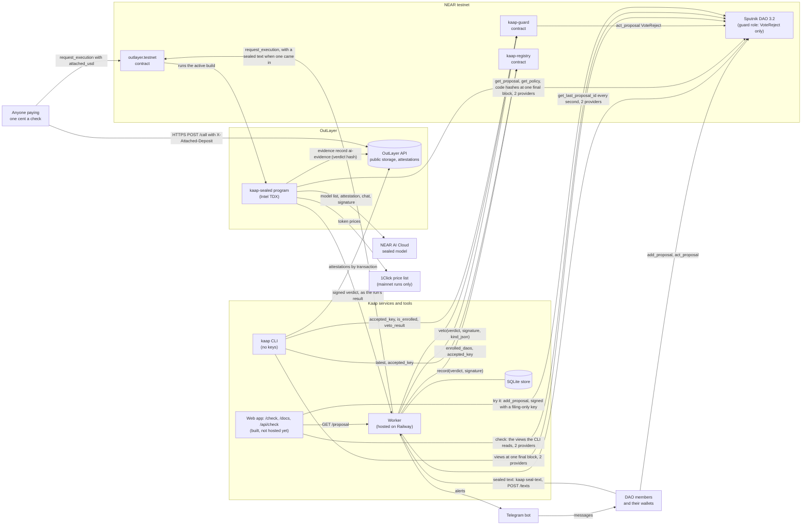
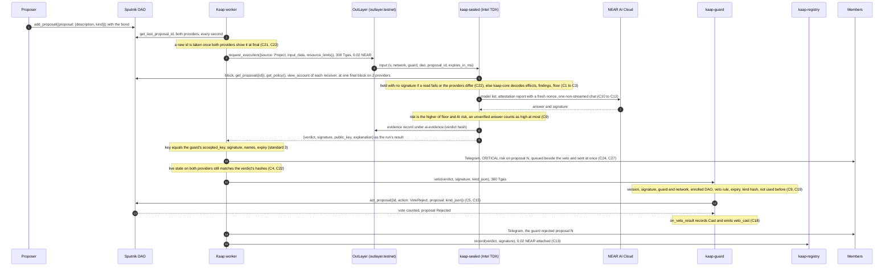
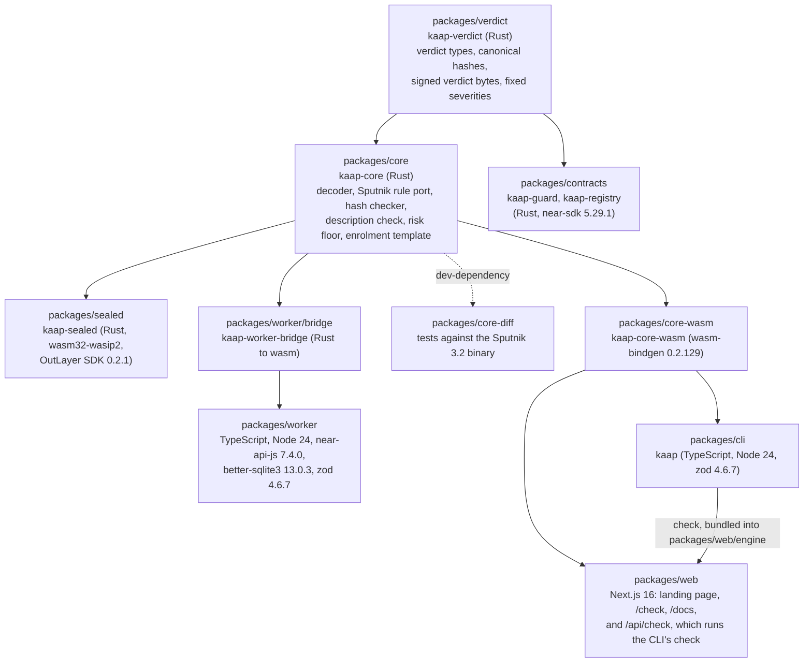

Three drawings of the same system. The repository's `ARCHITECTURE.md` goes further: every contract method, the verdict's byte layout, and the exact reads and writes between the parts.

## The parts

Kaap is two contracts on NEAR, one program inside sealed hardware on OutLayer, and three tools around them: the watcher, the command line and this site. Members and their wallets stay where they are, in the treasury.

Solid lines are calls that happen today. The watcher has been hosted since 12 Nov 2026 and watches the demo treasury. In the first recorded run, made the day before, a script made its calls.

## A disguised payment gets vetoed

The same path as [The path of a request](/docs/how-it-works/the-path-of-a-request), with every call named.

The veto goes out before the record, because the veto races the approvers and the record does not.

## The code

An arrow points from a package to the one built on it.

Two things in this drawing carry most of the trust:

- **The contracts compile in one small package, `verdict`, and nothing else of Kaap.** Work on the rules engine never changes the contracts' code.
- **Every part that judges a request runs the same engine.** The sealed reader, the command line and this site's check all run `kaap-core`, compiled from one source. The site does not have its own copy of any rule.
