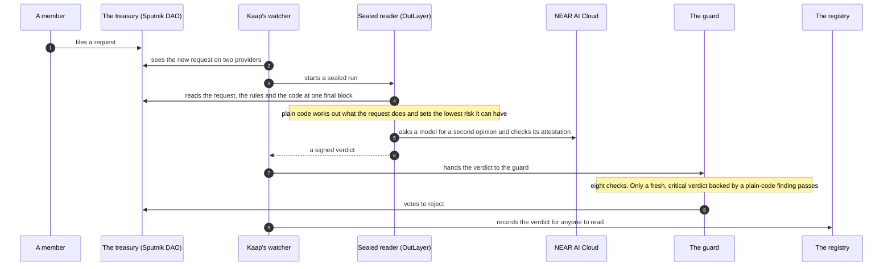

This is the path a disguised payment took on NEAR testnet on 11 Nov 2026, from filing to the guard's reject vote. It took 24.1 seconds.

## The parts

- **The watcher** follows the request counter of every enrolled treasury on two providers. It starts sealed runs, hands verdicts to the guard, records them and sends alerts. It decides nothing itself and its key cannot make the guard vote.
- **The sealed reader** is the judge. It runs on OutLayer inside sealed hardware. It reads the chain, runs the rules, asks the AI, and signs the verdict with a key that exists only for this program. See [The sealed reader](/docs/how-it-works/the-sealed-reader).
- **The guard** is a contract on NEAR. It checks a verdict and casts one vote: reject. See [The guard](/docs/how-it-works/the-guard).
- **The registry** is a contract that keeps every verdict the sealed reader signed. Nothing in it is ever overwritten, and anyone can read a verdict and check its signature.

## Why the veto comes before the record

The veto races the treasury's approvers: a request can pass the moment enough of them sign. So the watcher sends the verdict to the guard first and records it in the registry after.

## What a member does

Nothing changes in how a treasury works. Members file and vote as before, in the same wallet and the same interface. When Kaap rates a request medium or higher, members who follow the treasury on Telegram get a message. When the guard rejects one, they get another.

<Callout title="What is running today">
The guard, the registry and the sealed reader are live on testnet. The watcher is built and tested but not hosted yet, so in the recorded proof a script played its part. See [Limits](/docs/trust/limits).
</Callout>
